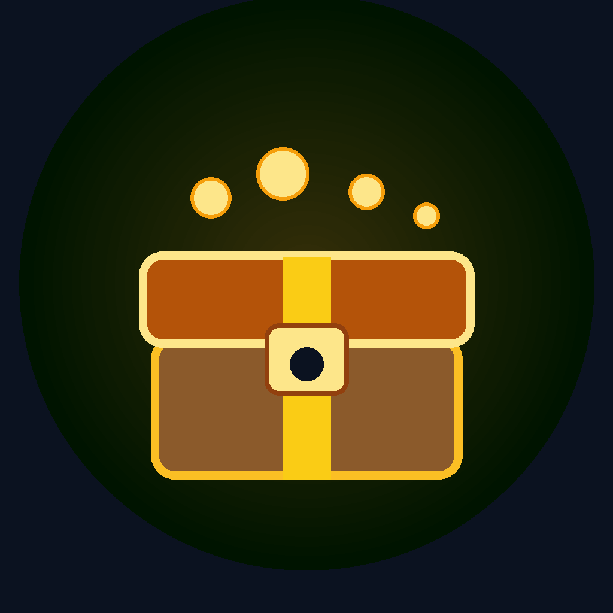
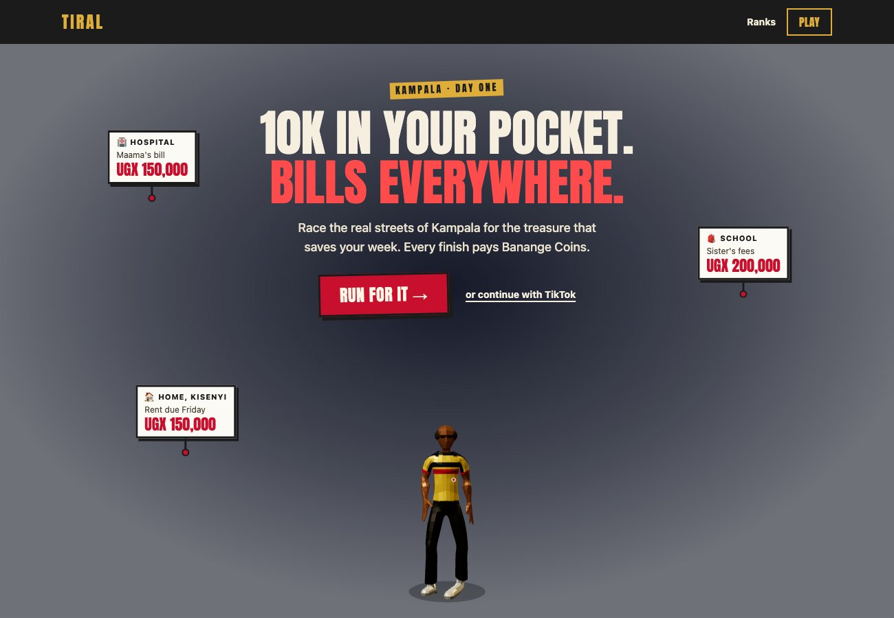
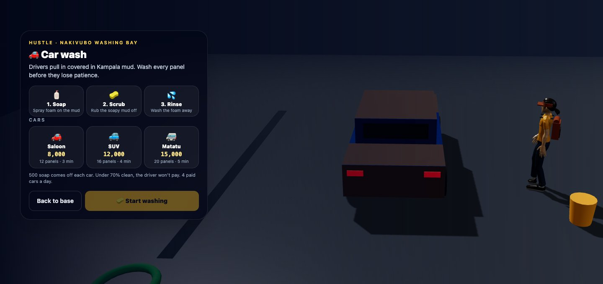
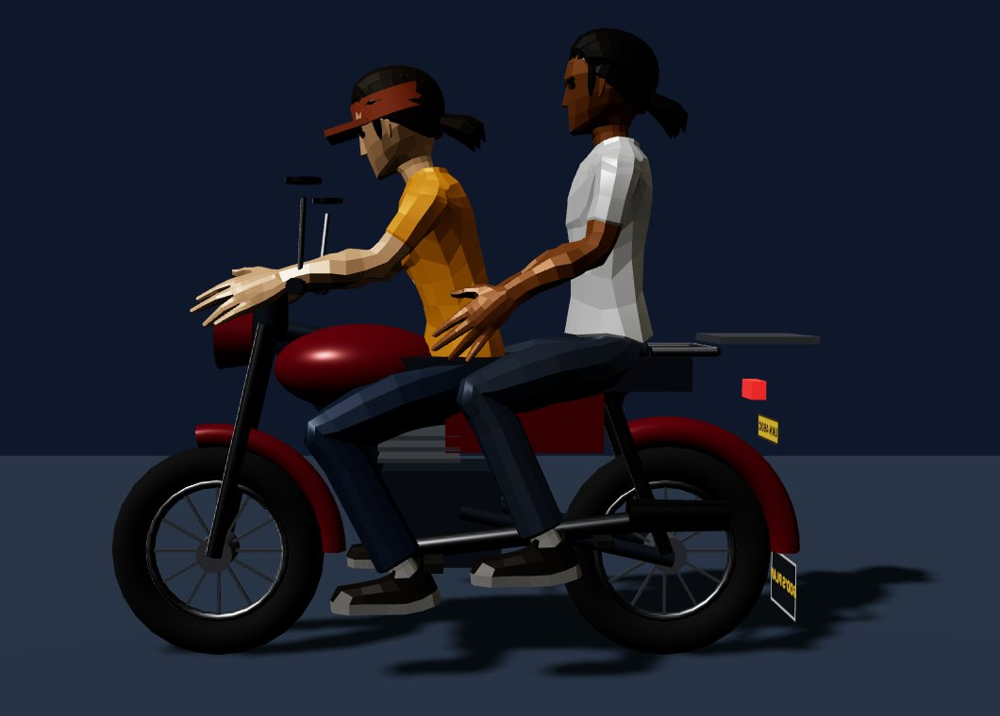

# Tiral: Kampala Hustle

<p align="center">
  
</p>

A multiplayer browser game set on the real streets of Kampala. You arrive in
the city with 10,000 in your pocket and bills everywhere. Race other players
for treasure, work hustles (porter, boda rider, car washer, rolex seller), pay
rent, look after your family, and save up for your own boda.

Web-first: no installs. Open a link on your phone and play.



## What you can do

### 🏁 Treasure races
Join a lobby, pick a starting point, and when the countdown hits zero the
bounty is revealed somewhere in town. Run the real OpenStreetMap road network.
There are no set routes, so shortcuts are fair game. The first to arrive wins
Banange Coins (BNG). The server checks every step and every finish.

### 🛵 Hustles: simulated gigs
Gigs never wait for other players. Passengers, customers and cars are
simulated, so there's always work.

| Hustle | What you do | Pay (BNG) |
|---|---|---|
| 📦 **Kikuubo porter** | Pick up goods at a pin on the map and carry them to the shop | per job, by distance |
| 🛵 **Boda passengers** | Collect passengers at stages and ride them across town on a 3D boda | fare by distance, tips for speed, minus fuel |
| 🍳 **Rolex stand** | Buy stock, then crack eggs, add veg, whisk, fry, flip and roll rolexes for customers at a 3D street stall. Run when KCCA raids | 2,000 a rolex (+500 if perfect) |
| 🚗 **Car wash** | Soap, scrub and rinse every panel of a muddy car in a 3D washing bay | 8,000 to 15,000 a car |



### 🏍️ Own a boda
Start on a rented stage bike. Then buy or lease-to-own one of five models.
Each has its own speed, fuel use and wear. Bikes need servicing and break down
if neglected. Decorate them in the customisation shop with paint, seat covers,
stickers, tassels, crash bars, underglow and plate slogans. Parts carry over
between bikes.



### 🏠 Life in the city
- **Needs:** energy and health. Sprinting drains energy. Eat gonja, chapati,
  rolex or a full plate to recover, and rest at home.
- **Rent** is due every week. Miss it and you move down to a cheaper place.
- **Stress** goes up with bad shifts and debt, and down with good days.
- **Family requests and shocks:** school fees, a hospital bill, a burst pipe.
- **Wallet:** every coin goes into an append-only ledger. No real money ever
  buys BNG.

## Tech stack

| Layer | Choice |
|---|---|
| Web client | Next.js 15, React, TypeScript, Tailwind |
| Map | MapLibre GL JS + OpenStreetMap (greater Kampala) |
| 3D | Three.js + React Three Fiber + drei (avatars, bikes, car wash bay) |
| Multiplayer | Colyseus 0.18, authoritative rooms: `race`, `hustle`, `stall` |
| Database | PostgreSQL with Drizzle ORM (postgres.js) |
| Sign-in | Guest accounts and TikTok login, signed session cookie |
| Tests | Vitest for the game rules in `game-core` |
| Deploy | Docker Compose on a VPS behind nginx |

## Project structure

```txt
apps/
  web/            # Next.js client: landing, hub, map, races, hustles, home, wallet
  game-server/    # Colyseus server: RaceRoom, HustleRoom, StallRoom
packages/
  game-core/      # Pure, tested rules: races, economy, needs, life, hustles, bikes, stalls
  db/             # Drizzle schema, migrations, coin ledger, garage, life settlement
  avatars/        # Avatar looks and loadouts
  houses/         # House catalogue and rent tiers
  road-graph/     # OSM graph build, snapping, traversal, turn classification
  map/            # Mercator projection and map↔3D camera sync
  routing/        # Route utilities
  config/         # Shared TypeScript configs
data/map/         # Prepared local map assets
infrastructure/   # Dockerfiles, docker-compose, nginx config
docs/             # Economy design and progress tracker (docs/economy-progress.md)
```

## Quickstart

Requirements: Node 20+, pnpm 9, and a PostgreSQL database.

```bash
pnpm install

# Database: point DATABASE_URL at Postgres (in apps/web/.env.local), then migrate
pnpm --filter @tiral/db db:migrate

# Game server (ws://localhost:2567, race listings on http://localhost:2568/races)
pnpm --filter @tiral/game-server dev

# Web client (http://localhost:3000)
pnpm --filter @tiral/web dev
```

Or run both servers with `pnpm dev`. The game server reads the same
`apps/web/.env.local` (`DATABASE_URL`, `SESSION_SECRET`).

### Environment variables

| Variable | Used by | Purpose |
|---|---|---|
| `DATABASE_URL` | web, game | Postgres connection |
| `SESSION_SECRET` | web, game | Signs session cookies; the game server checks them on join |
| `TIKTOK_CLIENT_KEY`, `TIKTOK_CLIENT_SECRET`, `TIKTOK_REDIRECT_URI` | web | TikTok login |
| `ADMIN_USER_IDS`, `ADMIN_SECRET` | web | Who may read `/api/admin/stats` (player ids, comma-separated) and the header secret for scripts |
| `NEXT_PUBLIC_GAME_URL`, `NEXT_PUBLIC_RACES_API_URL` | web | Where the client finds the game server |
| `PORT` (2567), `API_PORT` (2568) | game | WebSocket and HTTP ports |
| `RACE_COUNTDOWN_SECONDS` (20) | game | Lobby countdown |
| `RACE_ARRIVAL_RADIUS`, `HUSTLE_ARRIVAL_RADIUS` | game | Arrival radius in metres |

See `infrastructure/docker/server-env.example` for a full production example.

### Checks

```bash
pnpm --filter @tiral/game-core test   # game rules
pnpm typecheck
```

## Controls

- **Walk** (hold) or **Auto walk** (toggle) moves you along the current road.
- **Left / Straight / Right** asks for a turn at the next junction.
- **Turn around** reverses direction anywhere on a road.
- **Sprint** goes faster but burns energy.
- Desktop: `W/↑` walk · `A/←` left · `D/→` right · `S/↓` turn around ·
  `Shift` sprint · `Space` stop.
- Car wash: pick Soap, Scrub or Rinse and drag on the car. ↺ ↻ walk around it.

## Status

- [x] Real-road races with matchmaking, join codes, results and leaderboard
- [x] Guest and TikTok sign-in, profiles, avatars, houses
- [x] Coin ledger, wallet history, food shop, energy and health
- [x] Rent, stress, family requests and shocks
- [x] Hustles: porter, boda passengers, rolex stand, 3D car wash
- [x] Bike ownership (buy, lease, upkeep, breakdowns) and customisation shop
- [x] 3D rolex stand
- [ ] H4: mobile money booth, renting out your bike
- [ ] App delivery gig (spec ready in `docs/economy-progress.md` §16.12)

The full design, research and build log live in
[`docs/economy-progress.md`](docs/economy-progress.md).
